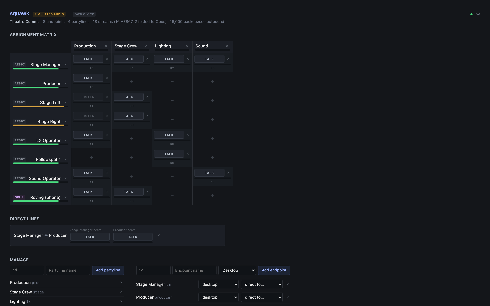

# squawk

> **AI-assisted project.** This codebase was created with [Claude](https://claude.com/claude-code)
> (Anthropic), directed and reviewed by a human author. Audio goes in and out over real AES67
> multicast, with mix-minus checked sample-exact through the round trip, and PTP drives the media
> clock. **But all of it has only ever run over the loopback interface, against a grandmaster this
> project wrote itself.** There's no SAP, no client and no hardware yet, and nothing here has met
> another vendor's device, a real switch, or a microphone.

An open **partyline intercom** system: the software half of a Green-Go / Bolero / Clear-Com
style comms rig. A server does the mixing, and the endpoints talk and listen.

Each endpoint gets up to **10 keys**, and each key is its own AES67 stream carrying either a
**partyline** (the bus, minus that endpoint's own voice) or a **direct** point-to-point path.
Because the keys arrive separately, a panel changes its own key levels, mutes and ear placement
instantly and locally, with no round trip to the server.



<sub>The browser UI on the example show: eight endpoints across four partylines, each key with its own talk button and a meter of what it hears, and a direct line between Stage Manager and Producer. It's running with no interface given, so the audio is synthesised tones and nothing reaches the network, and the page says so in its own badges.</sub>

## Status

| Piece | State |
|---|---|
| Data model, config, validation (`squawk-core`) | Built and tested |
| Mix-minus engine (`squawk-engine`) | Built and tested |
| Server + browser UI (`squawk-server`) | Built and tested |
| AES67 packets, SDP, jitter buffer, sockets (`squawk-rtp`) | Built and tested over real UDP |
| Transport wired into the server | **Working** — audio in and out over real multicast |
| PTP slave (`squawk-ptp`) | Built; locks to a synthetic grandmaster |
| PTP driving the media clock | **Working** — RTP timestamps are PTP time |
| SAP discovery | Not started |
| Tray packaging (via `av-launcher`) | Not started |
| Desktop client station | Not started |
| Opus/WebRTC leg for phones and browsers | Not started |
| Hardware endpoint (ESP32 / Pi class) | Not started |

## The two transports, and why there have to be two

Wired clients and hardware panels get real **AES67**: L24 RTP at 1 ms packet time, PTP-locked,
one stream per key.

Phones, browsers and anything off the LAN get **Opus over WebRTC** instead, and not by choice. No
phone exposes PTP, and wifi multicast goes out at the basic rate with no retries, so AES67 over
wifi doesn't degrade gracefully. It falls apart. The server bridges the two domains.

The mix engine knows nothing about any of this, on purpose. It puts out one stream per key, and
the fold-down to a stereo Opus mix happens downstream. So there's one mixing implementation and
one set of tests.

## Mix-minus

Every member of a partyline hears the bus minus their own voice. Taken literally, that's a
separate sum per member, O(members²), and it doesn't need to be:

```
contribution[key]  = mic × talk_ramp × bus_trim      (once per key)
bus[p]             = Σ contribution[keys on p]        (once per bus)
feed[key on p]     = bus[p] − contribution[key]       (once per key)
```

The subtraction is *exact*, because it takes away precisely the buffer that was added: same
samples, same gain, same block. Two things follow from that, and both matter:

- **Every input must already be aligned into the server's clock domain.** An engine fed
  unaligned inputs leaks the talker back into their own ear, faintly, and nothing downstream can
  fix it.
- **The bus trim is folded into each contribution, not applied to the summed bus.** Trimming
  after the sum would subtract an untrimmed buffer from a trimmed one and leave `(1 − trim)` of
  the talker in their own ear, which you can't hear at unity gain and which is a mystery at any
  other setting. There's a test named after it.

The output limiter sits **per stream, after the subtraction**, for the same reason.

## Cost

Measured on an M-series Mac, release build, 32 endpoints × 10 keys = 320 streams, with every key
talking at once. That's the worst case the engine can be put in, and roughly what comms sounds
like when the show stops:

```
1.000 s of audio mixed in 34.4 ms   (29x realtime, 3.4% of one core)
```

Mixing isn't the constraint. **Packet rate is.** Those 320 streams at 1 ms come to 320,000
packets per second outbound, which has to be batched per tick (`sendmmsg`) from the start,
because it can't be bolted on later. Bandwidth is the lesser problem, at roughly 1.6 Mbit/s per
stream.

## The transport

`squawk-rtp` does RTP/L24 packetisation, AES67 session descriptions, the receive-side jitter
buffer, and the sockets. It's tested over real UDP rather than against a mock: audio goes out of
one socket and comes back in through another, sample-identical.

Three things in there are worth knowing about, because each of them fails without telling
anyone:

- **The jitter buffer is indexed by RTP timestamp, not by sequence number.** The timestamp *is*
  the media clock, and the sequence number is only a counter. A sequence-indexed ring scatters
  audio into the wrong slots at the 2^32 timestamp rollover, which comes round once every ~24.8
  hours at 48 kHz, so you can count on it landing mid-show.
- **Multicast groups are allocated sequentially from one base.** IPv4 multicast copies only the
  **low 23 bits** of the address into the Ethernet MAC, so 239.69.1.1 and 239.197.1.1 become the
  same MAC, and an IGMP-snooping switch delivers both to anyone who joined either. Sequential
  allocation keeps those bits distinct.
- **The buffer's capacity isn't its latency.** Depth sets the delay. Capacity is headroom for when
  the receiving thread gets descheduled and `poll` then hands over 40 packets at once. A ring
  sized to the depth throws away audio it had already received.

Measured on an M-series Mac, one thread, unbatched:

```
send_to: 292,000 packets/sec   (3.4 us per packet) — about 292 streams at 1 ms
```

That's just under the 320 streams a 32-endpoint system implies, and it's the measurement that
turns per-tick send batching from an optimisation into a requirement.

### Addressing

Multicast groups come from `(endpoint index, key slot)`, not from the engine's stream index. The
engine numbers streams sequentially, so adding a key to endpoint 0 shifts every stream after it.
Addressing off that number would silently re-point every multicast group in the building every
time somebody added a key in the UI. Deriving from identity means adding a key moves nothing
else.

Reordering or deleting *endpoints* still shifts things. The proper fix is to persist an
allocation per endpoint id, and it's worth doing before anyone deploys this.

## The clock

AES67 devices agree on the time by all slaving to one grandmaster, and their RTP timestamps *are*
that time counted in samples. Two senders on the same grandmaster produce identical timestamps
for the same instant, which is what lets a receiver line up streams from different manufacturers
without negotiating anything.

`squawk-ptp` implements the slave side of IEEE 1588-2008: message coding, the Best Master Clock
Algorithm, and a PI servo. It locks to a synthetic grandmaster over real sockets in about 0.6 s
and **drives the server's media clock**: every outgoing RTP timestamp is PTP time counted in
samples, measured within 2.4 ms of the grandmaster across a run, with the gap wandering by only
55 samples.

Two things had to be true for that, and only one of them is obvious:

- **The timestamps come from PTP.** Obvious.
- **The audio loop is paced by PTP too.** Less obvious, and the failure is slow enough to look
  like something else. If timestamps advance one block per tick while the ticks come from a local
  crystal 20 ppm fast, the error builds up at about a sample a second, so every couple of minutes
  the timestamps are a packet or two ahead of the time they claim and have to be snapped back.
  That's a glitch on every stream, with nothing in the logs to connect it to the crystal.

**PTP runs on its own thread**, not in the audio loop. Draining it once per 1 ms tick quantises
every Sync receive timestamp to the tick while the slave's own Delay_Reqs go out straight away,
and PTP can't tell that asymmetry from clock offset. Measured, that was ~150 µs of offset that
wasn't there, and it never reached lock. On its own thread the same setup settles at **±40 µs**.

### Software timestamping, and what it costs

Proper PTP timestamps in the NIC, as the packet crosses the wire. This one timestamps in
userspace when the kernel hands the packet over, which includes interrupt latency and scheduling:
tens of microseconds of noise, against tens of nanoseconds in hardware.

At 48 kHz one sample is 20.8 µs, so this lands at roughly **±1 sample**. That's fine for speech on
an intercom and no good for phase-coherent summing. macOS doesn't expose hardware timestamping at
all. On Linux, `SO_TIMESTAMPING` with a capable NIC is the upgrade path, and it isn't
implemented.

### To see what is on your network

```bash
cargo run --release -p squawk-ptp --example ptpmon -- --iface 192.168.1.90 --domain 0
```

"No grandmaster" and "listening on the wrong domain" look identical from the outside, so it
counts messages from other domains and tells you when to try `--domain 127`.

## The browser UI

It's an assignment matrix, endpoints down and partylines across. Click a cell to give that
endpoint a key on that partyline, and the key lands in the next free slot. Each cell has its own
**talk** button and a meter showing what that key is actually hearing, so you can watch mix-minus
working: key someone up and every other meter on the bus rises while their own stays dark.

Direct lines get their own section, since a point-to-point pair doesn't fit rows and columns.
Creating one makes **both** halves. A direct key with no key back carries silence, and a UI that
could make one could make a dead button.

Validation problems show up live at the top, with errors and warnings kept apart. Errors reject
an edit and warnings don't, because an empty partyline or a half-patched direct line is a
perfectly normal thing to be in the middle of.

## Run it

Without an interface, every microphone is a synthesised tone and nothing reaches the network.
That's handy for looking at the UI, and the page says so in as many words:

```bash
cargo run --release -p squawk-server -- --config squawk.example.toml
```

With one, it receives and transmits real AES67:

```bash
cargo run --release -p squawk-server -- --config squawk.example.toml \
  --interface 192.168.1.90 --ptp-domain 0
```

Without `--ptp-domain` the media clock is the server's own, which agrees with itself and with no
other manufacturer's device. Either way the UI is at <http://localhost:8477>, and it says which
clock it's on.

`--interface` is required rather than auto-detected, on purpose. On a multi-homed machine (which
is every AV server) the routing table usually prefers the office LAN, and multicast sent the
wrong way reports success and is heard by nobody. On the Mac this was developed on, the default
route for 239.0.0.0/8 pointed at a **VPN tunnel**.

**Run the server in release.** A debug build can't hold the 1 ms tick: measured over 10 seconds
with 16 streams, debug ran 9802 blocks with 1.1% of ticks late, and release ran 10030 with none.

To feed a stream without a client (handy for testing against real gear, too):

```bash
cargo run --release -p squawk-rtp --example tone -- \
  --iface 127.0.0.1 --group 239.69.128.0 --hz 440
```

And for a bench with no grandmaster on it (never leave this running on a real network: it
announces a GPS-class clock and will win the BMCA against most equipment):

```bash
cargo run --release -p squawk-ptp --example grandmaster -- --iface 127.0.0.1
```

## Layout

```
crates/squawk-core      Data model, TOML config, validation
crates/squawk-engine    Mix-minus engine and per-stream limiter
crates/squawk-ptp       PTPv2 slave, BMCA, servo, disciplined media clock
crates/squawk-rtp       RTP/L24, AES67 SDP, jitter buffer, UDP sockets
crates/squawk-server    Engine host, HTTP/WebSocket API, browser UI
crates/diag             Vendored fleet diagnostics
squawk.example.toml     A worked four-partyline theatre system
docs/ARCHITECTURE.md    Signal path, clock domains, transport split
```

## Test it

```bash
cargo test --workspace
```

For the scale test's timing:

```bash
cargo test --release -p squawk-engine --test scale -- --nocapture
```

<!-- attributions:start -->
This project is built on other people's work — see [ATTRIBUTIONS.md](ATTRIBUTIONS.md).
<!-- attributions:end -->

## Licence

MIT, see [LICENSE](LICENSE).
